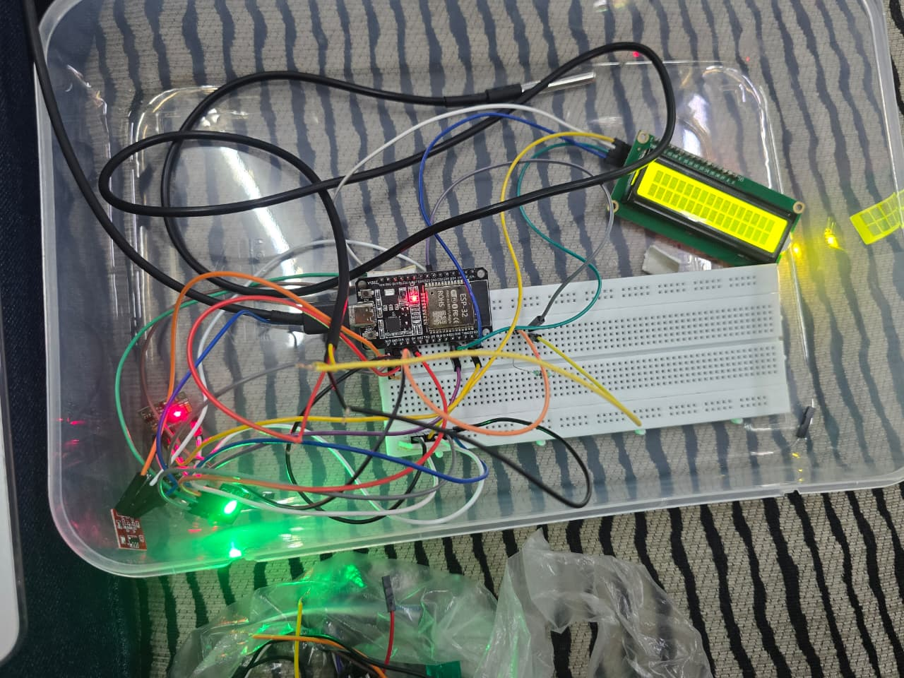
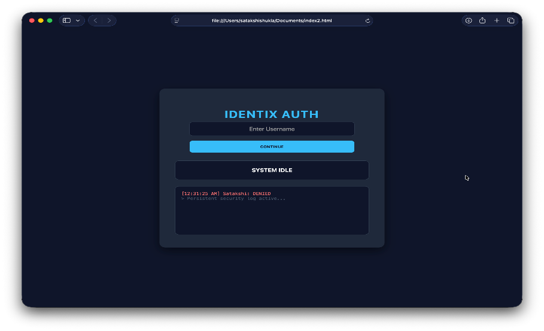
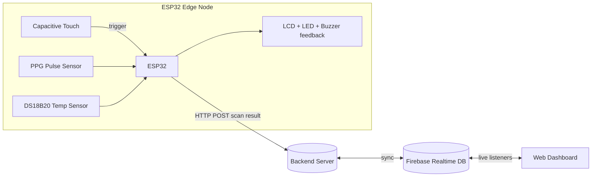

# IDentix — Sensor-Driven Human Recognition System


IDentix is an IoT-based biometric authentication prototype that identifies people from their **physiological signals** — heart rate (PPG) and skin temperature — instead of passwords, cards, or static biometrics like fingerprints. A capacitive touch trigger starts an 8-second sensor scan on an ESP32, the readings are compared against a threshold-based baseline, and the result ("Recognized" / "Unknown") is pushed to a real-time web dashboard.

Built as a Computer Science (IoT) mini-project by Muskan Gupta, Satakshi Shukla, Shreya Pathak, and Vashu Singh at NIET, Greater Noida.

<p float="left">
  
  
</p>

## Why physiological signals?

Passwords get guessed or leaked. Fingerprints and faces can be spoofed with a replica, a photo, or a mask, and both only check identity once, at the door — they can't tell if the authorized person is still the one in front of the system. Physiological signals (heart rate, skin temperature) are harder to fake because they come from live internal processes, and IDentix stores only abstract baseline values, not names, images, or biometric templates.

## Features

- **Touch-triggered acquisition** — an 8-second scan only starts on a live human touch, filtering out accidental or spoofed inputs.
- **Dual-sensor fusion** — combines PPG heart rate with DS18B20 skin temperature for a simple multi-parameter signature.
- **Threshold-based recognition** — no ML model required; a baseline + tolerance window classifies the user as *Recognized* or *Unknown*.
- **Real-time web dashboard** — live status, BPM/temperature readout, and an audit log of recent scans.
- **Privacy-preserving by design** — stores physiological patterns, not identity documents or biometric templates.

## System architecture



Data flows through three layers: **acquisition** (sensors → ESP32), **processing/storage** (backend → Firebase), and **visualization** (web dashboard). See [Known limitations](#known-limitations--todo) below — the backend layer as documented in the original project needs one decision made before it's fully wired end-to-end.

## Hardware

| Component | Function | Operating Voltage | Interface |
|---|---|---|---|
| ESP32 Dev Module | Central processing & Wi-Fi node | 3.3V logic | GPIO, I²C, Wi-Fi |
| Infrared Pulse Sensor (PPG, e.g. MAX30100) | Heart rate acquisition | 3.3V–5V | Analog/I²C |
| DS18B20 | Skin temperature | 3.0V–5.5V | 1-Wire digital |
| Capacitive touch sensor | Liveness trigger / activation | 2.0V–5.5V | Digital |
| 16x2 I2C LCD | Status display | 5V | I²C |


## Software stack

| Layer | Technology |
|---|---|
| Firmware | Arduino IDE, C/C++ (ESP32 core) |
| Sensor libraries | MAX30100lib, OneWire, DallasTemperature, LiquidCrystal I2C |
| Connectivity | Wi-Fi (HTTP), Firebase Realtime Database |
| Backend | PHP (XAMPP) — *see note below* |
| Dashboard | HTML / CSS / vanilla JavaScript, Firebase JS SDK |

## Repository structure

```
IDentix/
├── firmware/
│   └── identix_esp32/
│       ├── identix_esp32.ino     # ESP32 sketch (sensors, LCD, LEDs, HTTP POST)
│       └── secrets.example.h     # copy to secrets.h and fill in your own values
├── web/
│   └── index.html                # real-time dashboard (Firebase-backed)
├── docs/
│   └── images/                   # hardware photo + dashboard screenshots
├── LICENSE
└── .gitignore
```

## Getting started

### 1. Firmware (ESP32)

1. Open `firmware/identix_esp32/identix_esp32.ino` in the Arduino IDE.
2. Install the ESP32 board package, and these libraries via Library Manager: `LiquidCrystal I2C`, `MAX30100lib`, `OneWire`, `DallasTemperature`.
3. Duplicate `secrets.example.h` as `secrets.h` in the same folder and fill in your Wi-Fi credentials and backend server address.
4. Wire up the components per the pin definitions at the top of the sketch (touch → GPIO32, DS18B20 → GPIO33, buzzer → GPIO2, LEDs → GPIO4/12/14).
5. Select your board/port and upload.

### 2. Web dashboard

1. Create a Firebase project and enable the Realtime Database.
2. In `web/index.html`, replace the placeholder `databaseURL` in `firebaseConfig` with your own project's URL.
3. Open `index.html` locally, or host it (GitHub Pages, Firebase Hosting, etc.).

### 3. Backend

The original design POSTs scan results from the ESP32 to a local PHP endpoint (`save_data.php` on XAMPP), while the dashboard reads/writes Firebase directly — see [Known limitations](#known-limitations--todo) for how to close that gap.

## Results (from prototype testing)

- Sensor calibration confirmed stable DS18B20 readings and consistent PPG pulse detection (minor fluctuations from finger placement/motion, reduced via averaging).
- Recognition results were generated within a few seconds of touch, driven by the 8-second sampling window plus lightweight threshold comparison.
- The system reliably distinguished registered users from unregistered ones in testing, within the defined BPM/temperature tolerance.

## Known limitations / TODO

This repo is cleaned up for GitHub from the original project report, with a couple of honest gaps flagged rather than silently papered over:

- **Backend script not included.** The firmware POSTs to `save_data.php` on a local XAMPP server, but that PHP script wasn't part of the source report and isn't in this repo yet. Two ways to close the loop: (a) write a small PHP script that receives the POST and relays it into your Firebase Realtime DB (`scan`/`logs` nodes), or (b) simplify by having the ESP32 write to Firebase directly via its REST API and drop the PHP layer.
- **`currentUser` on the firmware side.** The dashboard sets `currentSession` in Firebase after PIN verification, but the ESP32 sketch doesn't currently read it back — it POSTs a placeholder username. Fetching `currentSession` from Firebase before each scan would connect the two halves properly.
- **PINs are stored in plaintext** in the Realtime Database. Fine for a class demo; hash them (and lock down your Firebase security rules) before any real deployment.
- **Local IP hardcoding.** `BACKEND_HOST` needs to be updated whenever your dev machine's LAN IP changes — fine for a prototype, but a mDNS hostname or cloud endpoint would be more robust.

## Future enhancements

- Replace threshold matching with an adaptive ML model trained per user.
- Move to a wearable/compact form factor for continuous, contactless verification.
- Add GSR/ECG/motion sensors for multi-modal recognition.
- Encrypt data in transit and at rest; harden Firebase security rules.
- Companion mobile app.

## Team

| Name | Roll No. |
|---|---|
| Muskan Gupta | 240133XXXXX78 |
| Satakshi Shukla | 240133XXXX107 |
| Shreya Pathak | 240133XXXX116 |
| Vashu Singh | 240133XXXX138 |

Project guide: Prof. Steven David · HoD: Prof. Mayank Deep Khare · Department of Computer Science (IoT), Noida Institute of Engineering and Technology, Greater Noida.

## License

MIT — see [LICENSE](LICENSE).
